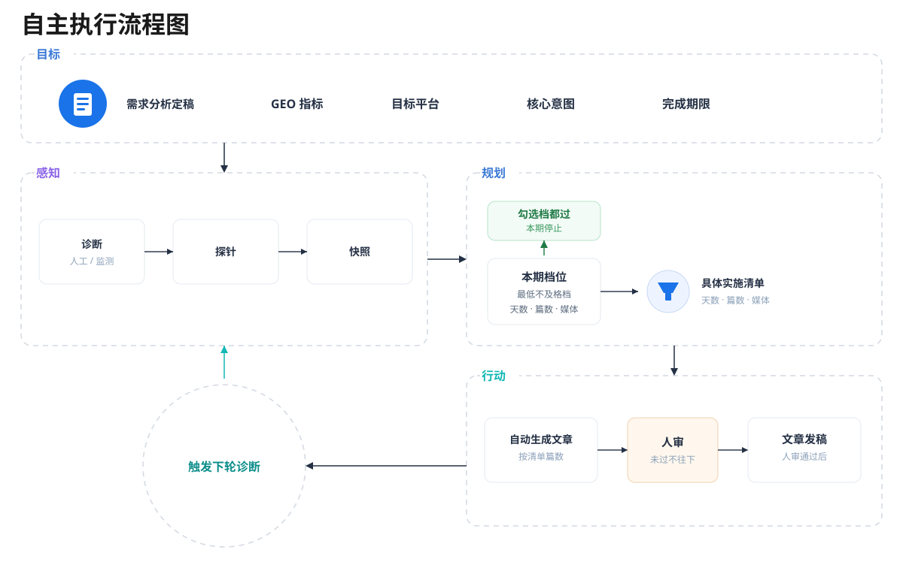

+++
date = '2026-11-25T11:10:00+08:00'
draft = false
title = 'Design and Implementation of a Self-Planning GEO (Generative Engine Optimization) Service Agent'
description = "Through the actual development, project practice, and continuous use of its GEO services, Zhengzhou Shuneng Software has completed and now runs a service agent dedicated to enterprise brand building. Autonomous planning runs through the entire solution: around a defined brand growth objective, the agent senses the brand's presence in generative engines through real questions, determines the current goal and a concrete implementation checklist from diagnostic results and fixed business rules, and then supports content generation, compliance review, and human-reviewed publishing on top of the enterprise knowledge base. After publishing, real links enter the content assets, and continuous monitoring and citation attribution verify the effects of actions, with new data feeding the next round of planning. Measurement evidence, planning rules, enterprise facts, and human accountability are brought into a single pipeline, enabling GEO services to keep executing, verifying, and adjusting — forming the agent-based infrastructure for enterprise brand building."
categories = [
    "Artificial Intelligence",
    "AI Agents",
    "GEO & Digital Marketing",
    "Technical Practice & Cases"
]
tags = [
    "GEO",
    "Generative Engine Optimization",
    "AI Visibility Diagnostics",
    "Self-Planning Agent",
    "Brand Visibility",
    "Citation Attribution",
    "Enterprise Knowledge Base",
    "Content Compliance",
    "Human-in-the-Loop",
    "Agent Governance"
]
+++

# Design and Implementation of a Self-Planning GEO (Generative Engine Optimization) Service Agent

**— The core infrastructure with which Zhengzhou Shuneng Software empowers enterprise brand building**

---

## Introduction: GEO Needs a Complete Navigation System

Users are now asking generative engines — Doubao, DeepSeek, Wenxin Yiyan (ERNIE Bot), Tongyi Qianwen (Qwen), Kimi, Tencent Yuanbao — their questions directly. Brands need to know whether these models mention them unprompted, where they appear in the answers, and whether the answers cite the brand's own pages. Fixed rankings in traditional search can no longer capture these changes.

Simply producing more content cannot answer these questions. An enterprise also needs to know: which platform performs weakest, which query patterns have gaps, and whether the current priority should be building brand awareness, improving sentiment, winning citations, or increasing visibility in category-related queries.

The Shuneng GEO workbench chains these tasks into a repeatable business pipeline: measure first, then plan; produce content grounded in the enterprise knowledge base; register real links after publishing; and finally re-test with the same set of questions. The diagnostic data serves as the dashboard, the planning rules choose the route, and content production is only one step of execution.

---

## I. Autonomous Execution Pipeline Design

The Shuneng GEO service agent is the autonomous execution component of the Shuneng GEO workbench; it operates around a defined brand growth objective. The objective specifies the GEO metrics to improve, the target platforms, the core intents, and the deadline; the enterprise knowledge base supplies the facts, and monitoring projects provide a set of questions for continuous re-testing. On this basis, the agent completes perception, planning, action, and feedback.

The service agent consists of four core modules — goals, perception, planning, and action: finalized requirements define the goals; diagnostics, probes, and snapshots handle perception; planning selects the current target metrics and a concrete implementation checklist; and action completes writing, human review, and publishing, then triggers the next round of diagnostics.

The complete pipeline has seven steps:

1. Finalize the brand objective — metrics, platforms, core intents, and deadline;
2. Build the enterprise knowledge base, set up continuous monitoring projects, and define the question set;
3. Run the visibility diagnosis, perceiving the external environment through probes and snapshots;
4. Generate target metrics and a concrete implementation checklist from the report;
5. Automatically generate articles and complete compliance checks;
6. Wait for human review; once approved, publish according to the checklist and register the real links;
7. When the scheduled monitoring time arrives, re-test automatically, then return to diagnosis and planning.

The first three steps answer "what is the goal, and what does the environment look like"; the fourth decides "what to do this round"; the fifth and sixth carry out the action; and the seventh feeds the results of the action back into perception. Every round retains a clear state; when conditions are not met, the process stops at the corresponding gate, and resumes once they are satisfied.

---

## II. Perception: Building the GEO Dashboard with Real Questions

Perception is where the service agent starts running.

In "AI visibility diagnosis," the user selects the brand, competitors, questions, and target engines. The system sends real questions to the configured generative engines and retains every question-and-answer record. The diagnostic report then computes brand mention rate, top-3 share, awareness, negative share, and citation status.

These Q&A records act as the agent's probes. Each probe corresponds to one specific question, one engine, and one real answer — every figure in the report can be traced back, item by item, to the raw evidence. Generative engines naturally vary in their answers, so metrics are never judged on a single response: at the report level, figures are aggregated from the valid answers to multiple questions on the same engine; at the effect level, judgment is based on the trend of the fixed question set across re-test cycles. When valid answers are insufficient, the system marks the item as untested; it never fills the gap with simulated results.

At the end of the diagnosis, the system also examines the source links in the answers and matches them against the official website, articles, videos, and channel links registered in the workbench. Matching first attempts an exact full-URL match to a specific content asset; because engines routinely truncate or rewrite links, the official domain serves as a fallback to confirm the source as an enterprise-owned asset. For engines that return no source links, citation metrics are excluded from statistics, and only mentions and positions are measured.

The website radar, the enterprise knowledge base, and the monitoring projects supply three more kinds of information to perception: whether the official website clearly states the enterprise's identity, which facts are available for writing, and which fixed questions future re-tests should continue to use.

---

## III. Planning: Rules Decide the Goals — the Model Does Not Rewrite Them for the Enterprise

Once the diagnostic report is complete, "Strategy & Planning" reads the latest results and generates a five-level strategy ladder:

1. Awareness;
2. Sentiment index;
3. Citation share;
4. AI visibility;
5. TOP visibility.

The system checks in this fixed order and opens only the lowest level that has not yet met its bar. Here, awareness refers to whether the model has formed a stable, consistent, and correct recognition of the brand — distinct from brand awareness in the consumer-survey sense. When a brand has not yet formed stable awareness, it first establishes a unified definition; when there is clearly negative information, it adds verifiable cases; when models do not cite the brand's own pages, it first builds citable content; when the brand is absent from category-related queries, it then improves visibility; and when the brand appears but ranks low, it finally works on top-3 placement.

Within the target metric, the system further selects the platforms and specific query patterns to improve, forming an implementation checklist that specifies content direction, target channels, execution volume, and re-test timing — and proceeds to article generation accordingly. The choice of target channels likewise comes from diagnostic evidence: the system prioritizes publishing domains that have already appeared as citations in this question set's answers — including domains where competitor content is cited — rather than rotating a fixed media list.

The autonomous plan comes from diagnostic data and fixed business rules; it does not depend on the session model deciding on the spot — what the industry calls a deterministic workflow, in which process routing and state transitions are executed by fixed rules while the model only organizes text in the subsequent writing stage. The model cannot modify the pass thresholds, and it cannot present a direction without evidence as already accomplished.

Goal determination, content generation, and effect evaluation are handled by different stages, preventing a single model from simultaneously setting the goals, producing the content, and grading its own results.

---

## IV. Action: Knowledge Base Drafts; Compliance and Publishing Are Gatekept by Humans

**Knowledge-base drafting**

The enterprise knowledge base is the factual boundary of writing. The workbench maintains enterprise profiles, products, cases, FAQs, and layered vocabularies. Confirmed content becomes available for semantic retrieval and provides the basis for articles, video scripts, and content rewrites.

The agent calls the article-writing capability according to the implementation checklist and reads facts from the knowledge base fixed for the current round. Directions already occupied in the same knowledge base are skipped, and batch tasks cap how much is processed at once. Model numbers, prices, qualifications, and customer names the enterprise has not provided will never be filled in by the model on its own.

**Machine compliance review**

After an article is generated, the agent immediately runs rule checks and model-assisted review to identify exaggerated claims, absolute statements, or insufficient factual support. Articles that pass compliance move on to human review; blocked articles stay in a pending state until operations staff revise them and the checks are re-run.

**Human approval and publishing**

Once human review is passed, the agent matches the permitted media resources according to the implementation checklist, submits publishing tasks, and tracks their status. Real links returned by the platforms are registered automatically; channels that require manual publishing — such as the official website — pause and wait, and the process continues after the link is filled in.

Throughout the action stage, machines execute and humans release. Human review is a formal gate in the pipeline: articles that are unreviewed or rejected are never published; once approved, the agent goes on to complete publishing and link registration.

---

## V. Feedback: Real Links Connect Content to Outcomes

An article being written and published only means the action is complete. Whether it produces GEO effects depends on whether generative engines subsequently mention the brand or cite the relevant pages.

**Content assets and citation attribution**

The workbench registers the official website, published articles, videos, and channel links uniformly as content assets. Only real, accessible URLs enter citation attribution; drafts without public links are never counted as owned citations.

**Continuous monitoring and strategy refresh**

Continuous monitoring preserves the brand's questions, competitors, and engines, and re-tests on a daily, weekly, biweekly, or monthly cycle. Subsequent rounds keep using the established question set, avoiding misjudging effects by changing the questions each time; the set is curated during question design so that semantically duplicate queries are removed and each question maps to an independent information gap. Because published content takes weeks to be crawled, indexed, and retrieved by engines, effectiveness is judged primarily on monthly trends, not on daily fluctuations.

When a new report comes out, the system recalculates mentions, rankings, sentiment, and citations, and refreshes the strategy readings. The team can see whether a lower-level goal has slipped back below the bar, whether the current query pattern has improved, and whether newly published content has entered model citations.

**The bar for effect attribution**

The feedback results can directly answer:

- Why was this piece written? Because the diagnosis found a clear gap;
- Why this platform and this query pattern? Because the rules ranked it as the current target;
- Why could the body be written this way? Because the knowledge base supplied the facts;
- Why is the action considered effective? Because the fixed question set showed changes in mentions, rankings, or owned citations in the next round of real answers.

Attribution must still account for confounding factors: engine model updates, retrieval-corpus changes, and competitor moves all create fluctuations unrelated to the content, so a single period's rise or fall cannot be taken directly as a content effect. The system's approach is to keep the question set unchanged, rely on aggregated readings across multiple questions, mark insufficient samples as untested, and place effect judgment on trends across re-test cycles rather than the ups and downs of any single answer.

---

## VI. Governance Boundaries in Autonomous Execution

An enterprise-grade service agent still needs human stages to carry governance responsibility. Without stable fact sources, clear rules, traceable evidence, and human release, autonomous continuous operation would rapidly amplify errors.

The system constrains autonomous execution through three boundaries:

**Measurement cannot be modified by the writing model.** Raw data comes entirely from real questions and answers; labels such as sentiment and awareness are assigned by a measurement model, independent of the writing model, under fixed criteria — and when the measurement model is not configured or its call fails, the item is recorded as untested, with unknown results never reported as neutral mentions.

**Planning cannot be freely decided by the model.** The current goal is produced by the fixed ladder and the pass rules.

**Public publishing retains human accountability.** The agent drafts automatically and completes compliance checks; publishing proceeds only after human review is passed.

For every round, the agent saves the goals, snapshots, implementation checklists, articles, published assets, and execution status. After planning completes, it moves into writing automatically; after human review is passed, it continues with publishing; after real links are registered and the monitoring time arrives, it first saves the next diagnosis task, then closes the round and triggers the re-test.

When the objective is missing, the knowledge base is missing, compliance blocks an article, the budget is insufficient, or channels are unavailable, the system enters the corresponding pending state. Once the issue is resolved, the process continues from where it stopped — it never repeats completed actions.

---

## Conclusion: Let Autonomous Execution Keep Clear Boundaries of Accountability

The GEO service agent gives every step an explicit reason, verifiable evidence, and an execution boundary, keeping content production anchored to brand objectives.

The Shuneng GEO service agent brings real diagnosis, rule-based planning, knowledge-base writing, compliance and human review, media publishing, content assets, citation attribution, and continuous monitoring into one autonomous pipeline. It works like a "GEO service colleague" — one who has a dashboard, navigation rules, enterprise knowledge, and a clear sense of when a human must confirm.

Enterprise-grade agents need to connect facts, rules, actions, and feedback into a reliable closed loop, and to embed responsibility boundaries into the process. The system takes on the repetitive work governed by clear rules; people spend their energy on the stages that call for judgment and accountability.
